# 本手⚫⚪
---

## 為什麼要用本手？

101圍棋的作業列表只告訴你「這份作業幾分」。做了幾千題之後，真正想知道的問題它答不出來：

- 我的 **死活** 到底進步了沒有？
- **對殺** 和 **吃子**，哪個比較弱？
- 我是 **想太快就下錯**，還是 **想很久還是錯**？
- 哪些題我 **已經錯第三次了**？
- 我 **可以升級做更難的題了嗎**？

本手把每一題的等級、題型、黑先／白先、用時、對錯全部讀出來，替你整理成下面這些畫面。

[前往本手](https://connorxwolf.github.io/101Weiqi-Web-app/app.dc.html)
---

## 功能一覽

### 📊 總覽：一眼看完近四週

做題數、答對率、錯題與答對題的用時比、答錯兩次以上的題數，全部在第一頁。
達到升級門檻（答對率 ≥ 90%、題數 ≥ 100）的組合會直接告訴你「可升級」，差一點的也會告訴你還差多少。

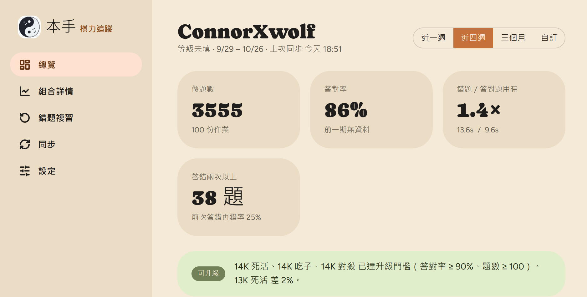

### 🧩 各等級 × 題型

每個組合（例如 11K 死活、9K 官子、13K 對殺）各自一張卡片：

- 答對率與趨勢線（進步／持平／退步）
- 距離升級門檻還差幾 %
- 答對題 vs 錯題的平均思考時間
- 快錯比例（≤ 8 秒就答錯的題）

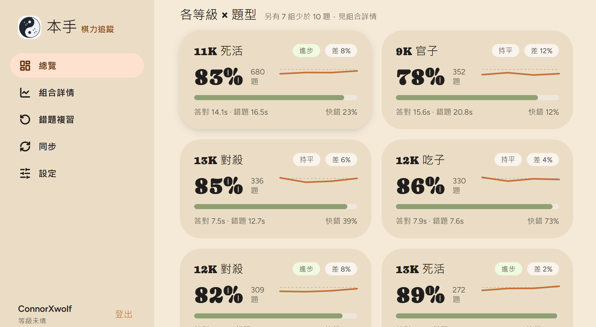

### 📈 組合詳情：每週答對率趨勢

點進任一組合，看每週的答對率與題數，升級門檻線畫在圖上。

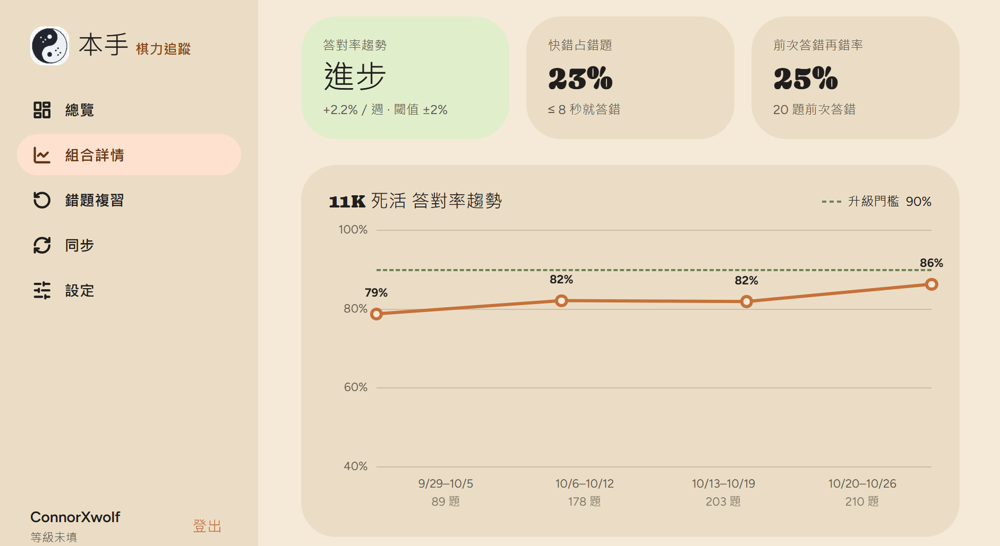

錯題依用時分成 **快錯 / 中間 / 慢錯**，分辨是「看錯、太急」還是「真的不會」。

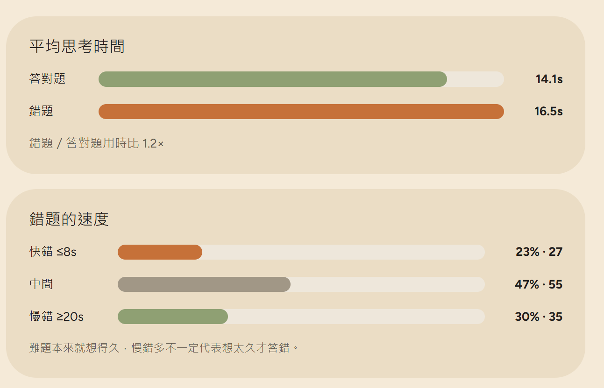

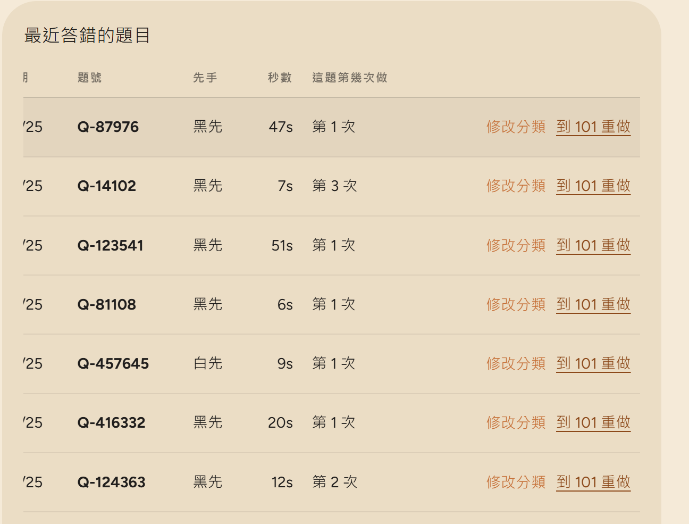

### 🔁 錯題複習

列出答錯兩次以上（或三次以上）的題目，可依組合、黑先／白先篩選。
按「到 101 重做」直接開啟原題。

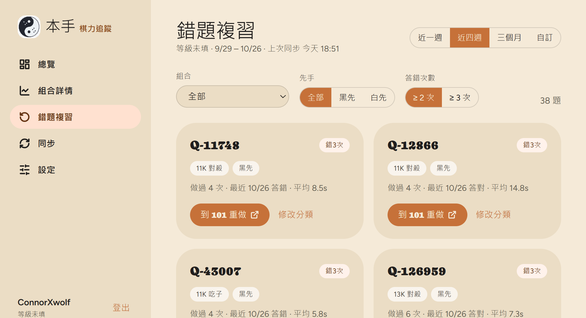

### 🏷️ 題型分類：照你的習慣分組

- 依 101 題目頁面的題型自動分類，預設依等級拆開（10K 死活、11K 死活⋯）
- 可以把幾個題型 **合併** 成自訂組合（例如把 13K～15K 死活合併成「簡單死活」），之後也能拆回來
- 每個組合可個別 **調整升級門檻**
- 不想影響答對率的題型（例如錯題重做）可設為「只計錯題」

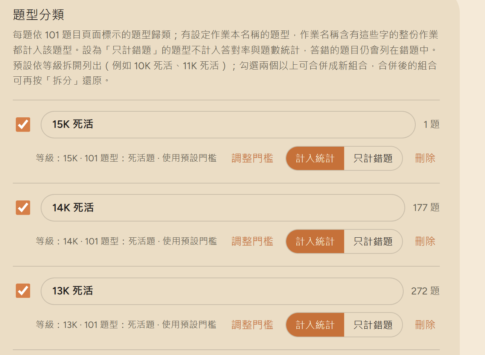

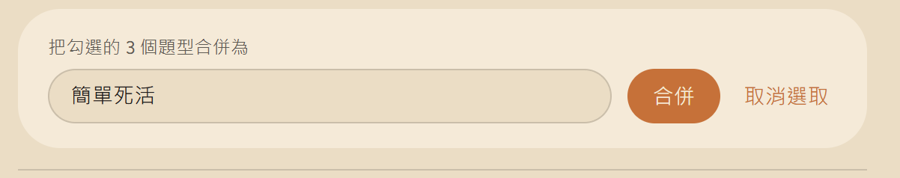

---

## 安裝擴充功能

本手需要一個瀏覽器擴充功能，負責在 101 的「我的作業」頁面讀取你的做題紀錄。支援 Chrome、Edge 及其他 Chromium 瀏覽器。

1. 到 [Releases](https://github.com/ConnorXwolf/101weiqi-web-app/releases/latest) 下載最新的 `benshou-extension.zip`，解壓縮到一個不會被刪掉的資料夾。
2. 在網址列輸入 `chrome://extensions`（Edge 為 `edge://extensions`）。
3. 打開右上角的 **開發人員模式**。
4. 按 **載入未封裝項目**，選擇剛剛解壓縮的資料夾。
5. 在工具列釘選 **本手** 圖示，方便之後使用。

> 擴充功能資料夾之後不要移動或刪除，否則擴充功能會失效。更新時下載新版覆蓋同一個資料夾，再到擴充功能頁按「重新載入」。

---

## 同步 101 作業

### 第一次使用

1. 點工具列的本手圖示，按 **開啟 101「我的作業」**。

   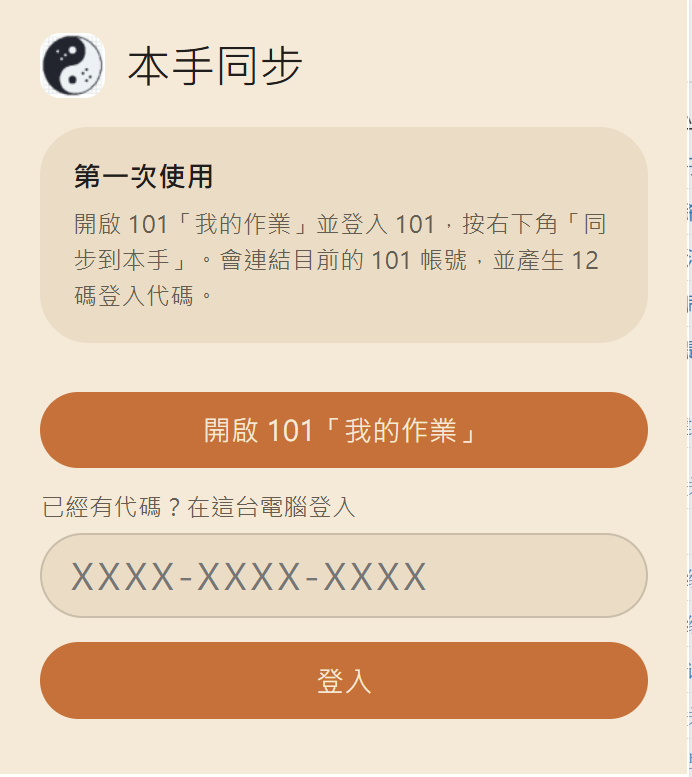

2. 登入你的 101 帳號，進入「我的作業列表」。
3. 按右下角的 **同步到本手**。

   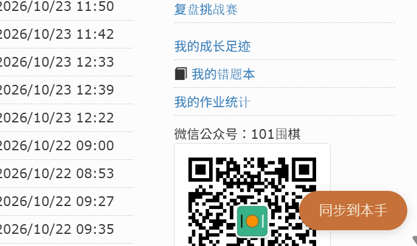

4. 等待讀取完成。進度會顯示在右下角（例如「讀取各題等級、題型與先手 20/2783」）。第一次需要逐題讀取，會較久，大約需要5分鐘；之後只會讀新的題目。

   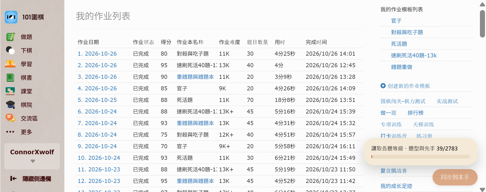

5. 完成後會連結目前的 101 帳號，並產生一組 **12 碼登入代碼**（`XXXX-XXXX-XXXX`），然後自動開啟本手。

> 請保存好這組代碼，它是你在其他電腦登入本手的唯一方式。

### 之後每次同步

做完作業後，到 101「我的作業」按一次 **同步到本手** 即可。本手總覽右上角會顯示上次同步時間。

### 在任何裝置查看

開啟本手，輸入 12 碼代碼，按 **登入**。
[前往本手](https://connorxwolf.github.io/101Weiqi-Web-app/app.dc.html)
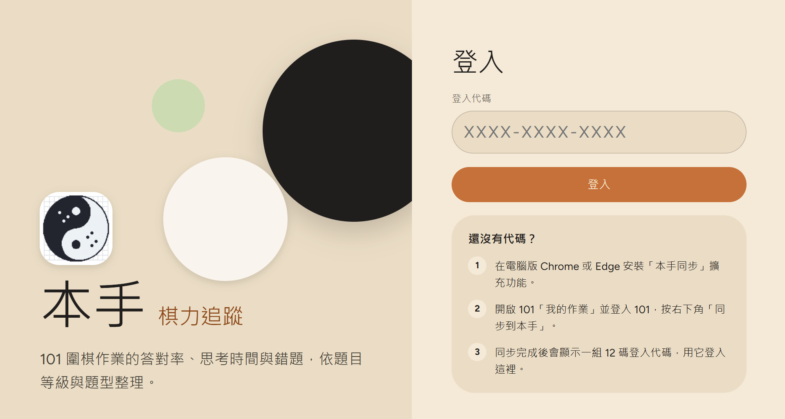

---

## 常見問題

**Q：一定要用電腦嗎？**
同步需要在電腦版瀏覽器安裝擴充功能。查看統計可用任何瀏覽器(手機、平板皆可)。

**Q：為什麼顯示「等級未填」？**
到「設定」填入你目前的等級即可。

**Q：題目分類不對怎麼辦？**
在組合詳情或錯題複習中，按題目旁的 **修改分類** 手動調整。

**Q：本手會改動我的 101 帳號嗎？**
不會。擴充功能只讀取「我的作業」頁面上的紀錄。

---

## 回報問題

歡迎在 [Issues](https://github.com/ConnorXwolf/101Weiqi-web-app/issues) 回報錯誤或提出建議。

## 支持本手

本手免費使用。如果它對你的練習有幫助，歡迎請作者喝杯珍奶，支持後續維護與新功能開發。

## 授權

[MIT](LICENSE)

本專案與 101圍棋網（101weiqi.com）無官方關聯。
